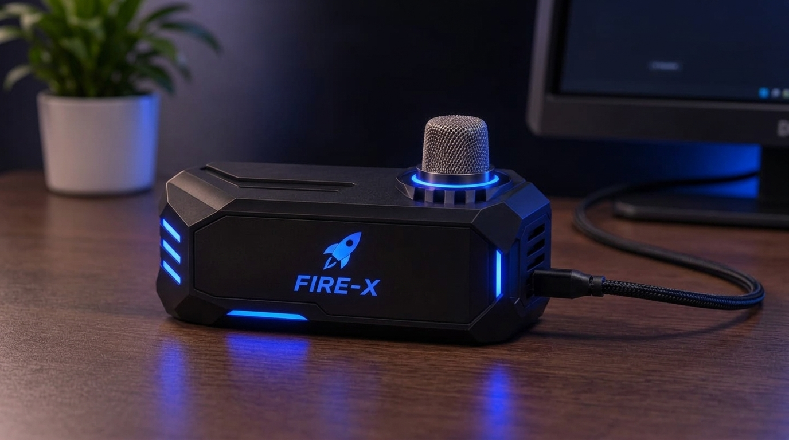
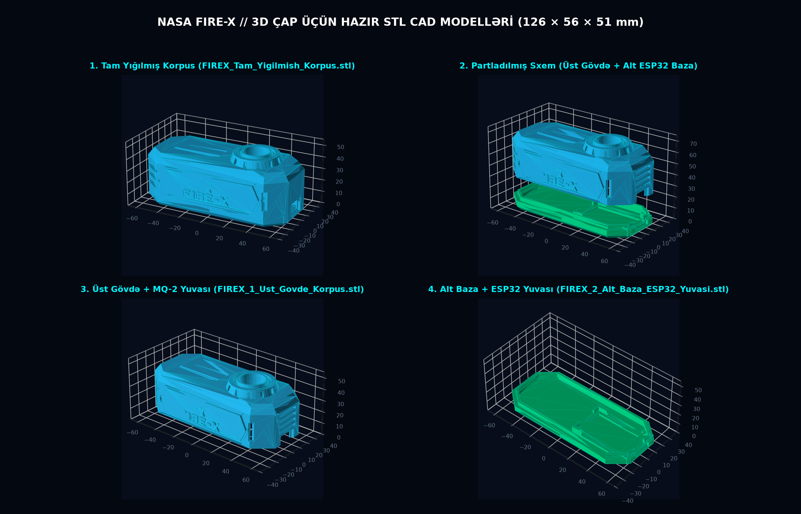

# 🚀 NASA FIRE-X // 3D-Printable IoT Sensor Enclosure (`Node-01`)

**3D CAD & Printable `.STL` Enclosure Repository for the FIRE-X Microgravity Combustion & Gas Telemetry Station**  
*NASA Space Apps Challenge — Flame in Freefall: Fire Safety Insights from Microgravity Combustion Data*

---

## 📸 Physical Concept & 3D CAD Preview

  

  

---

## 🌐 Live Interactive 3D Viewer

You can inspect, rotate 360°, zoom, toggle wireframe mode, and switch between **Assembled**, **Exploded View**, **Top Shell**, and **Bottom Base** directly in your browser:

👉 **[Launch Interactive 3D STL Viewer (`https://prototip-38u6.onrender.com`)](https://prototip-38u6.onrender.com)**

---

## 📂 Repository File Structure

All files are named using clean, standard engineering conventions and are ready to drop directly into any 3D printer slicer (**UltiMaker Cura**, **Bambu Studio**, **PrusaSlicer**, **Creality Print**):

| File Name | Type | Size | Description |
| :--- | :---: | :---: | :--- |
| **[`index.html`](./index.html)** | `WebGL / HTML` | `190 KB` | Standalone interactive Three.js 3D STL viewer with embedded geometry & exploded view controls |
| **[`firex-top-shell.stl`](./firex-top-shell.stl)** | `3D Mesh (.STL)` | `117 KB` | **Upper Main Body Shell** — Faceted geometric armor, 3D embossed Rocket + `FIRE-X` emblem, Ø 21.0 mm MQ-2 turret & side cooling louvers |
| **[`firex-bottom-base.stl`](./firex-bottom-base.stl)** | `3D Mesh (.STL)` | `22 KB` | **Lower Base Tray** — Integrated 30-pin ESP32 NodeMCU cradle, Dupont wire routing channels, snap-fit interlocking lip & Micro-USB port |
| **[`firex-assembled.stl`](./firex-assembled.stl)** | `3D Mesh (.STL)` | `123 KB` | **Full Assembled Preview** — Combined upper shell and lower base (`126.0 × 56.0 × 51.2 mm`) |
| **[`preview-render.jpg`](./preview-render.jpg)** | `Image (.JPG)` | `482 KB` | Industrial product render of the screenless matte-black enclosure with rear USB cable |
| **[`cad-blueprint.png`](./cad-blueprint.png)** | `Image (.PNG)` | `861 KB` | 4-angle orthographic & isometric 3D CAD mesh inspection chart |

---

## 📐 Mechanical & Dimensional Specifications

| Parameter | Specification | Engineering Notes |
| :--- | :--- | :--- |
| **External Footprint (`L × W × H`)** | `126.0 × 56.0 × 51.2 mm` | Compact benchtop / spacecraft bulkhead form factor |
| **Nominal Wall Thickness** | `2.8 mm` | High rigidity; zero flex under USB insertion force |
| **MQ-2 Sensor Turret Cutout** | `Ø 21.0 mm` (Through-Hole) | Fits standard `Ø 19.5 mm` stainless-steel mesh dome with `0.75 mm` radial thermal clearance |
| **ESP32 Internal Cradle Slot** | `53.0 × 29.8 mm` | Precision fit for **30-pin ESP32 ESP-WROOM-32 (`CP2102`)** (`51.5 × 28.5 mm` PCB) |
| **Under-PCB Pin Clearance** | `4.8 mm`Ledge + `18 mm` Overhead | Full clearance for pre-soldered header pins & Female-to-Female Dupont connectors |
| **Micro-USB Port Opening** | `13.0 × 8.0 mm` (`17 × 11.5 mm` Recess) | Accommodates thick braided Micro-USB data/power cables |
| **Enclosure Coupling** | `3.0 mm` Snap-Fit Lip (`0.3 mm` Tol.) | Tool-less friction/snap closure between `firex-bottom-base.stl` and `firex-top-shell.stl` |

---

## 🖨️ Recommended 3D Printer Slicer Settings

To print the physical enclosure, load **`firex-top-shell.stl`** and **`firex-bottom-base.stl`** into your slicer with the following parameters:

- **Filament Material:** Matte Black **PLA**, **PLA+**, or **PETG** *(UL-94 V0 flame-retardant polycarbonate/PETG recommended for flight-grade enclosures)*
- **Layer Height:** `0.20 mm` (`0.16 mm` for ultra-crisp front `FIRE-X` lettering)
- **Nozzle Diameter:** `0.4 mm`
- **Wall Line Count (Perimeters):** `3` (`1.2 mm` shell thickness)
- **Top / Bottom Layers:** `4` layers
- **Infill Density & Pattern:** `20%` **Gyroid** or **Grid**
- **Supports:** `Tree Support (Auto)` — *Touching Buildplate Only*

---

## 🔌 Hardware Bill of Materials (BOM) & Pinout

The enclosure houses a solderless 3-wire IoT gas & smoke telemetry node:

| # | Component | Specification | Quantity |
| :-: | :--- | :--- | :---: |
| **1** | **ESP32 Development Board** | `ESP32 ESP-32S (ESP-WROOM-32, CP2102, 30-Pin, Pre-soldered)` | `1×` |
| **2** | **MQ-2 Gas & Smoke Sensor** | `4-Pin Flying-Fish Module (SnO₂ chemiresistive dome)` | `1×` |
| **3** | **Dupont Jumper Wires** | `Female-to-Female (20 cm, 3 wires required)` | `3×` |
| **4** | **Micro-USB Cable** | `Data + Power USB 2.0 Braided Cable (1 m)` | `1×` |

### Pin-to-Pin Wiring Map (Inside the Enclosure)

| MQ-2 Sensor Pin | Wire Color | ESP32 30-Pin Header | Function |
| :--- | :---: | :--- | :--- |
| **`VCC`** | 🔴 Red | **`VIN`** (`5V` USB Rail) | `5V DC` supply for MQ-2 internal SnO₂ heater coil |
| **`GND`** | ⚫ Black | **`GND`** | Common ground reference |
| **`AO`** (Analog Out) | 🔵 Blue | **`D34` (`GPIO 34`)** | `12-bit ADC1_CH6` analog telemetry (`0 – 4095`, conflict-free while Wi-Fi is active) |

---

## 🛠️ Step-by-Step Assembly (Solderless, < 2 Minutes)

1. **Print Both Parts:** Print `firex-bottom-base.stl` and `firex-top-shell.stl`.
2. **Connect the 3 Dupont Wires:** Attach 3 Female-to-Female jumper wires to the MQ-2 module (`VCC`, `GND`, `AO`) and to the ESP32 (`VIN`, `GND`, `D34`).
3. **Mount the MQ-2 Sensor:** Insert the stainless-steel mesh dome of the MQ-2 sensor upward into the `Ø 21.0 mm` circular turret collar inside `firex-top-shell.stl`.
4. **Seat the ESP32 Board:** Place the 30-pin ESP32 board into the internal cradle on `firex-bottom-base.stl` with the Micro-USB port facing the side cutout.
5. **Snap the Enclosure Shut:** Press `firex-top-shell.stl` onto `firex-bottom-base.stl` and plug the Micro-USB data cable into the side port.

---

**Built for the 2026 NASA Space Apps Challenge · Project [NASA FIRE-X](https://github.com/Hekimovraiz/FIRE-X)**

